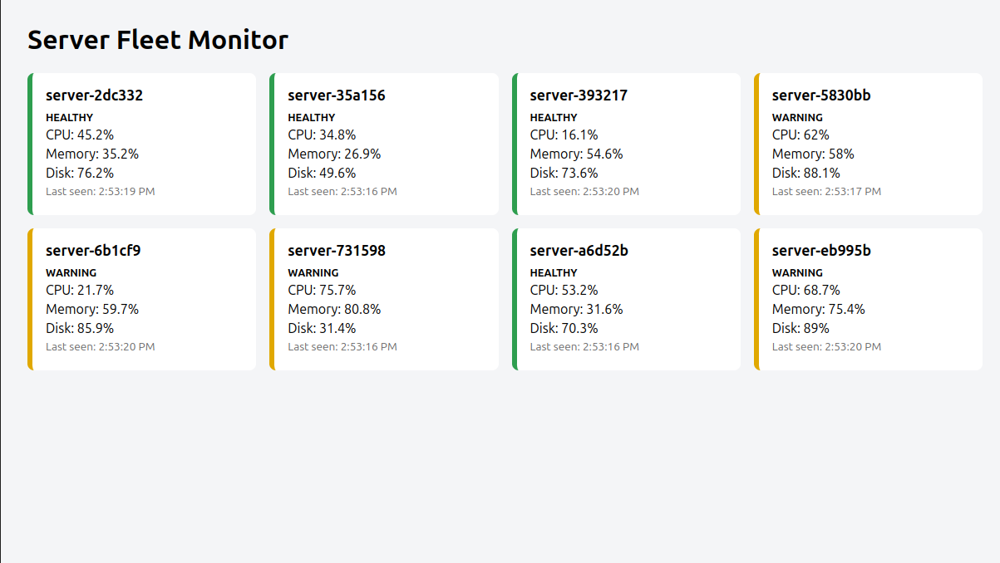
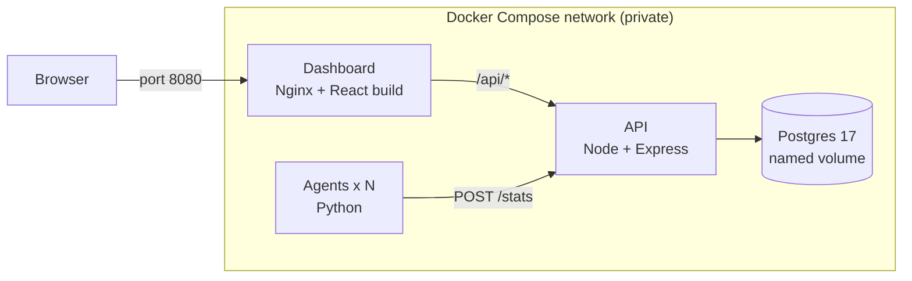

# Docker Fleet Monitor

A small server health dashboard that runs entirely in Docker. Simulated "servers" report their CPU, memory and disk usage to an API, the data is stored in Postgres, and a React dashboard (served by Nginx) shows which servers are healthy, warning, critical or down. One command starts everything.



> The metrics are random numbers generated by the agents. This project is about the Docker setup: how it is built, wired together, protected and recovered. It is not a real monitoring tool.

## Why I built it

I finished a Docker course and understood the basics, but I had not built anything real with it. I wanted a project that covers what matters in practice: multi-container apps, data that survives restarts, health checks, failure recovery, small images and backups. I picked server monitoring because reliability and automation is the area I want to grow in.

## Architecture



Nginx is the only published door. It serves the dashboard and forwards `/api/*` requests to the API over the private network.

## Tech stack

| Part | Technology |
|---|---|
| Agents (fake servers) | Python 3.12, `requests` |
| API | Node 24, Express 5, `pg` |
| Database | Postgres 17 |
| Dashboard | React 19 + Vite, served by Nginx |
| Orchestration | Docker Compose |

## Quick start

```bash
git clone https://github.com/Sais-27/docker-fleet-monitor.git
cd docker-fleet-monitor
cp .env.example .env        # then open .env and set your own DB_PASSWORD
docker compose up -d --build
```

Open http://localhost:8080. The first start takes a minute: images build, and the agents wait until the API reports healthy.

Stop it with `docker compose down` (keeps the data) or `docker compose down -v` (deletes the data too).

## Dev and prod modes

The base file `docker-compose.yml` holds what both modes share. Small layer files change the rest.

| | Dev (default) | Prod |
|---|---|---|
| Command | `docker compose up -d` | `docker compose -f docker-compose.yml -f docker-compose.prod.yml up -d` |
| Agents | 2, report every 1 s | 8, report every 5 s |
| API port | 3000 open for debugging | not exposed |
| Database port | 127.0.0.1:5433 open | not exposed |

The dashboard is always on port 8080. In dev, `docker-compose.override.yml` is loaded automatically.

## Try breaking it

```bash
docker compose stop api      # dashboard shows an error, agents keep retrying
docker compose start api     # recovers on its own within seconds
docker compose stop db       # API turns unhealthy; start db and everything comes back
docker compose start db
docker stop docker-fleet-monitor-agent-2   # that server's card turns grey after ~20 s
```

## Backup and restore

```bash
# back up
docker compose exec -T db sh -c 'pg_dump --clean --if-exists -U "$POSTGRES_USER" "$POSTGRES_DB"' > backup.sql

# restore (stop the agents first so nothing is writing)
docker compose stop agent
docker compose exec -T db sh -c 'psql -U "$POSTGRES_USER" -d "$POSTGRES_DB"' < backup.sql
docker compose start agent
```

I tested this for real: backed up, ran `docker compose down -v` to destroy the volume, started empty, restored from the file, and got all 11,223 rows back.

## Docker techniques used

| Technique | Where | Why |
|---|---|---|
| Multi-stage build | `dashboard/Dockerfile` | Build with Node, ship only static files on Nginx |
| Layer caching | all Dockerfiles | Dependencies installed before code is copied, so rebuilds are fast |
| Alpine base images | agent, API, Nginx | Smaller images |
| Non-root users | agent, API | Less damage if a container is compromised |
| Named volume | `db-data` | Database survives container deletion |
| Healthchecks + `depends_on` | db, API, dashboard | Services start in the right order, only when ready |
| Restart policies | all services | Containers come back after a crash |
| Resource limits | agents (0.25 CPU, 64 MB) | One container cannot starve the host |
| Replicas | `agent` service | Scale the fleet with one setting |
| Log rotation | all services | Logs cannot fill the disk |
| `.env` + `.env.example` | root | Secrets stay out of Git |
| `.dockerignore` | api, agent, dashboard | Smaller build context, no secrets copied by accident |
| Single published port | Nginx only | API and database are not reachable from outside |
| Compose layering | override + prod files | Dev and prod from one base |
| DNS re-resolution in Nginx | `dashboard/nginx.conf` | Survives the API container being recreated |

## Image sizes

| Image | Before | After | Change |
|---|---|---|---|
| Agent | 198 MB (Debian slim) | 92.1 MB (Alpine) | -53% |
| API | 352 MB | 265 MB | -25% |
| Dashboard | 564 MB (build stage with Node) | 92.8 MB (final: Nginx + static files) | -84% |

## Project structure

```
.
├── agent/                       # Python fake server
├── api/                         # Node + Express API
├── dashboard/                   # React app, Nginx config, multi-stage Dockerfile
├── docs/                        # screenshot and demo
├── docker-compose.yml           # shared base
├── docker-compose.override.yml  # dev layer (loaded automatically)
├── docker-compose.prod.yml      # prod layer
├── .env.example
└── README.md
```

## Pre-built images

Published on Docker Hub: `saisankat27/fleet-monitor-agent`, `saisankat27/fleet-monitor-api`, `saisankat27/fleet-monitor-dashboard`.

## Known limitations and next steps

- Metrics are simulated. Real ones (for example from `psutil`) would be the next step.
- A server that stops reporting stays on the dashboard as "down" forever, because names come from container IDs. A cleanup rule would fix it.
- No authentication or TLS. It is meant for local use.
- Passwords live in a local `.env` file. Docker secrets would be the next level.
- Planned: CI/CD with GitHub Actions, Kubernetes, Prometheus and Grafana, automated fixes with Ansible.
